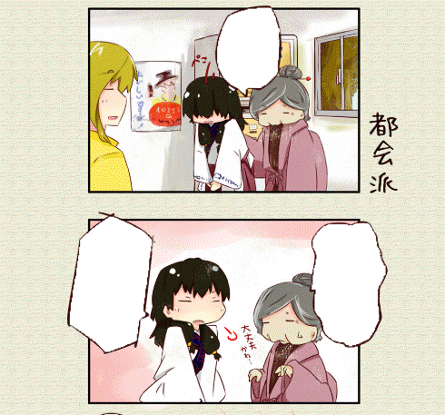

# mo-code-4koma
道草屋バックヤード漫画の配信用

### 1話1画像の simple 版

Python 3.10以降で、原本と既存の `4komaData.json` を変更せず、
話ごとに画像を上から順に結合した画像と、同じ形式の `4komaDataSimple.json` を生成できます。

```sh
python -m venv .venv
# Linux/macOS: source .venv/bin/activate
# PowerShell: .venv\Scripts\Activate.ps1
python -m pip install -r requirements-simple.txt
python generate-simple.py
```

- 出力画像: `4koma/ja/simple/{Index}.jpg`
- 公開パス: `/4koma/ja/simple/{Index}.jpg`
- 公開JSON: `/4komaDataSimple.json`
- `Title`・`BaseUrl`・`Index`・話順はそのまま、`ImagesUrl` だけを1件に置き換えます。

`ImagesUrl` は既存JSONと同じく、日本語画像ディレクトリ `/4koma/ja/` を基準にします
（JSON自身からの相対パスではありません）。たとえば第404話は次のようになります。

```json
{
  "Title": "同じ穴",
  "BaseUrl": "http://momoirocode.web.fc2.com/4koma/404.html",
  "ImagesUrl": ["./simple/404.jpg"],
  "Index": 404
}
```

背景の微細な模様をならして外周の余白だけを検出し、検出範囲に安全余白を付けて
切り抜きます。切り抜き対象は外周のみで、コマ間の余白・コマ外の文字やイラストは
残します。空の背景画像（`sp.jpg` など）は名前に依存せず除外します。
背景色が暗い場合や四隅の色が大きく違う場合は、安全のため切り抜きません。
実画像をぼかす処理ではなく、保存する絵は元画像から切り出します。

最大幅1600px・JPEG品質90・ページ間16px・外周16pxで、縦横比を保ち、拡大はしません。
結合後に縦横どちらかが2048pxを超える場合は、縦横比を保ったまま長辺が2048pxに
なるよう縮小します（VRChatの画像読み込み上限に対応）。切り抜きや分割はしません。
1話内の各画像を同じ倍率で扱い、原作のコマ配置や読む順序は変更しません。
タブレット縦持ちで横幅に合わせて読む想定のため、長い話は縦スクロールが必要です。
薄い線まで含めた自動判定には限界があるため、余白を確実にすべて残したい場合は
`--no-trim` を指定してください（空の背景画像も保持します）。

```sh
python generate-simple.py --no-trim
python generate-simple.py --max-width 2000 --max-dimension 2048 --gap 24 --padding 24 --quality 95
# 検出感度を上げる（余白が残りやすくなる）
python generate-simple.py --threshold 12
```

同じ入力・設定・Pillow版なら出力は同じになり、変更のないファイルは書き換えません。
元画像や話数の情報が欠けている場合はエラーで停止し、不完全なJSONを公開しません。

`NewUpdate`・`SkipFeed`・`GenerateWebP` でも原本の更新後に自動生成・コミットします。
手動再生成は GitHub Actions の **Generate simple episodes** → **Run workflow** でも実行できます。
スクリプトや設定を変更した場合は、生成結果も再生成してコミットしてください。

開発時の検証:

```sh
python -m pip install -r requirements-dev.txt
ruff check generate-simple.py test_generate_simple.py
ruff format --check generate-simple.py test_generate_simple.py
mypy generate-simple.py --check-untyped-defs
python -m unittest -v
```

### 透過画像を重ねる

[みちくさびゅあー](https://iranika.github.io/mo-code/)は多言語対応を目的として、画像の重ね表示(overlay)に対応しました。  
これにより、ビュアーで元画像の上に翻訳版の透過画像(gif)を重ねて表示することできるようになりました。  
次の画像は元画像に白吹き出しを重ねて表示した例です。  



現在は英語および中文繁体字の翻訳を対象にしていますが、他にも面白い利用ができるかもしれません。  
(関西弁やおもしろ吹き出し等)
もし何かをビュアーで表示させたい場合は、issueもしくはいらにか([@happy_packet](https://twitter.com/happy_packet))までご連絡ください。

### 翻訳作業への参加

翻訳作業に協力していただけるボランティアを募集しています。  
興味がある人はiranika[@happy_packet](https://twitter.com/happy_packet)までご連絡ください。  
Discordもありますので、ぜひJoinしてみてください。  
https://discord.gg/nfg3nZv

大まかに漫画の翻訳からリリースまでの流れを説明します。

1. 画像のダウンロード  
このリポジトリの[ここ](https://github.com/iranika/mo-code-4koma/tree/master/4koma/ja)から翻訳する画像を選んで、ダウンロードします。  
すべてのファイルをダウンロードしたい場合は、[このリンクをクリック](https://github.com/iranika/mo-code-4koma/archive/master.zip)してリポジトリ全てをダウンロードしてください。

1. 画像の加工（翻訳）  
翻訳する画像をGIMPやPhotoshop等のお好みの画像編集ソフトで加工します。  
翻訳にあたっての制約事項は下記の通りです。  
    - 保存時の名前は元画像と同じにしてください。
    - 可能な限り画像サイズ(縦横比率）は元画像と同じにしてください。
    - 画像はGIF形式で保存してください。  
    もしGIF形式で保存ができない人は、iranika[@happy_packet](https://twitter.com/happy_packet)までご連絡ください。  

1. 動作チェック  
翻訳データを元画像に重ねて表示したときの動作を確認します。  
https://github.com/iranika/mo-code-local/archive/master.zip  
上記のツールをダウンロードして、翻訳画像をビュアーで表示したときにどうなるか動作チェックができます。  
例えば中文繁体字で1.jpgを翻訳する場合は下記のように確認できます。
    1. 'mo-code-local/mo-code/mo-code-4koma/4koma/zh-tw/'に翻訳データ（1.gif)を保存します。
    2. 'mo-code-local/index.html'をChrome等のWEBブラウザで開きます。
    3. ビュアー右上のメニューから、言語「中文繁体字」を選ぶと翻訳データが元画像の上に表示されます。
    4. 翻訳データが正しく表示されているかチェックします。  
    もし、この工程が難しい場合はiranika[@happy_packet](https://twitter.com/happy_packet)までご連絡ください。  

1. 画像のアップロード  
Google DriveやNextCloudに共有フォルダがあります。  
共有フォルダのURLが知りたい人はiranika[@happy_packet](https://twitter.com/happy_packet)までご連絡ください。  
それ以外にも、Twitterで翻訳画像をDMで送ってもOKです。

#### 翻訳時の推奨ルール

- 貴方が何かしらの理由でこの推奨ルールを破るとき、私はそれを非難しません。  
このルールはクオリティマネジメントのために存在し、貴方の生み出すクオリティがルールを守ることで下がるのであれば、ルールを破って構いません。  
ただ、特に理由がなければ貴方は推奨ルールを守るべきです。  
統一されたルールは安定したクオリティを生み出すために効果的です。

何か問題があれば都度、ルールを定めて共有します。 
